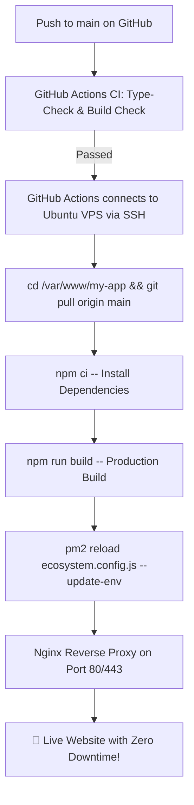

# 🚀 Ubuntu Fresh Server Setup & CI/CD Deployment Guide

This guide provides a complete, step-by-step walkthrough to deploy this **Next.js 16** application on a **brand-new, fresh Ubuntu Server (VPS)** using **Node.js 20, PM2, Nginx, and GitHub Actions CI/CD** with **Zero Downtime**.

---

## 📌 Architecture & Deployment Flow



---

## 🛠️ Step 1: Connect to Your Fresh Ubuntu Server

Open your terminal (PowerShell, Command Prompt, or Terminal) and SSH into your server:

```bash
# If using root user:
ssh root@<YOUR_SERVER_IP>

# Or if your cloud provider gave you a default user (e.g. AWS EC2, DigitalOcean):
ssh ubuntu@<YOUR_SERVER_IP>
```

---

## 📦 Step 2: System Update & Install Dependencies

Run the following commands on your fresh Ubuntu server:

```bash
# 1. Update package lists and upgrade existing packages
sudo apt update && sudo apt upgrade -y

# 2. Install essential tools (curl, git, build-essential)
sudo apt install -y curl git build-essential

# 3. Install Node.js 20 LTS from official NodeSource repository
curl -fsSL https://deb.nodesource.com/setup_20.x | sudo -E bash -
sudo apt install -y nodejs

# 4. Verify Node.js and npm versions
node -v   # Should show v20.x
npm -v    # Should show 10.x

# 5. Install PM2 (Process Manager) globally
sudo npm install -g pm2
```

---

## 🛡️ Step 3: Configure UFW Firewall (Security)

Allow SSH and web traffic (ports 22, 80, 443):

```bash
sudo ufw allow OpenSSH
sudo ufw allow 'Nginx Full'
sudo ufw --force enable
sudo ufw status
```

---

## 🔑 Step 4: Setup SSH Keys for GitHub Access

Your server needs permission to pull code from your GitHub repository:

### 1. Generate an SSH Key on the Ubuntu Server:
```bash
ssh-keygen -t ed25519 -C "ubuntu-deploy-key" -f ~/.ssh/id_ed25519 -N ""
```

### 2. View and Copy the Public Key:
```bash
cat ~/.ssh/id_ed25519.pub
```
*Copy the entire output line (starts with `ssh-ed25519 AAA...`).*

### 3. Add to GitHub:
- Go to your repository on GitHub: `https://github.com/digitalkstechno/cicd_test`
- Click **Settings** -> **Deploy keys** (in the left sidebar) -> **Add deploy key**.
- **Title**: `Ubuntu VPS Deploy Key`
- **Key**: Paste the public key copied above.
- Click **Add key**.

### 4. Verify Connection from Server:
```bash
ssh -T git@github.com
# Type 'yes' if asked. You should see: "Hi digitalkstechno/cicd_test! You've successfully authenticated..."
```

---

## 📂 Step 5: Clone & Initial Application Launch

Set up the application folder in `/var/www/my-app`:

```bash
# 1. Create directory and assign permissions to your user
sudo mkdir -p /var/www/my-app
sudo chown -R $USER:$USER /var/www/my-app

# 2. Clone your GitHub repository
git clone git@github.com:digitalkstechno/cicd_test.git /var/www/my-app
cd /var/www/my-app

# 3. Install dependencies
npm ci

# 4. Build the Next.js production bundle
npm run build

# 5. Start the application with PM2 cluster mode
pm2 start ecosystem.config.js

# 6. Save PM2 list so it restarts automatically if the server reboots
pm2 save

# 7. Configure PM2 system service
pm2 startup systemd
# (Run the exact `sudo env PATH=...` command that PM2 displays on your screen)
```

Verify your app is running:
```bash
pm2 status
curl http://localhost:3000
```

---

## 🌐 Step 6: Configure Nginx as Reverse Proxy

Install Nginx to route domain traffic (port 80/443) to Next.js on port 3000:

```bash
sudo apt install -y nginx certbot python3-certbot-nginx
```

Create an Nginx configuration file:
```bash
sudo nano /etc/nginx/sites-available/next-app
```

Paste the following configuration (replace `yourdomain.com` with your actual domain or server IP):

```nginx
server {
    listen 80;
    server_name yourdomain.com www.yourdomain.com; # Or your server IP

    location / {
        proxy_pass http://127.0.0.1:3000;
        proxy_http_version 1.1;
        proxy_set_header Upgrade $http_upgrade;
        proxy_set_header Connection 'upgrade';
        proxy_set_header Host $host;
        proxy_cache_bypass $http_upgrade;
        proxy_set_header X-Real-IP $remote_addr;
        proxy_set_header X-Forwarded-For $proxy_add_x_forwarded_for;
        proxy_set_header X-Forwarded-Proto $scheme;
    }
}
```

Enable the configuration and reload Nginx:
```bash
# Remove default site if present
sudo rm -f /etc/nginx/sites-enabled/default

# Enable your site
sudo ln -s /etc/nginx/sites-available/next-app /etc/nginx/sites-enabled/

# Test syntax and reload
sudo nginx -t
sudo systemctl reload nginx
```

### Free SSL Certificate (HTTPS) with Let's Encrypt:
If you have a domain pointed to your server IP:
```bash
sudo certbot --nginx -d yourdomain.com -d www.yourdomain.com
```
Certbot will automatically configure SSL renewal via systemd timer.

---

## 🔐 Step 7: Configure GitHub Actions CI/CD Secrets

To allow GitHub Actions to SSH into your server and run automated deployments:

### 1. Generate a Deploy Key for GitHub Actions:
On your server or local computer:
```bash
ssh-keygen -t ed25519 -C "github-actions-ssh" -f ~/.ssh/github_actions -N ""
```

Add the **public key** to your server's authorized keys:
```bash
cat ~/.ssh/github_actions.pub >> ~/.ssh/authorized_keys
chmod 600 ~/.ssh/authorized_keys
```

Display the **private key** to copy into GitHub:
```bash
cat ~/.ssh/github_actions
```

### 2. Add Secrets in GitHub:
Go to your GitHub repository -> **Settings** -> **Secrets and variables** -> **Actions** -> **New repository secret**:

| Secret Name | Value to Enter |
| :--- | :--- |
| `SERVER_HOST` | Your server public IP address (e.g. `198.51.100.1`) |
| `SERVER_USER` | Your server login username (e.g. `ubuntu` or `root`) |
| `SERVER_SSH_KEY` | The entire content of the **private key** (`~/.ssh/github_actions`) |
| `SERVER_PORT` | `22` |
| `APP_DIR` | `/var/www/my-app` |

---

## 🚀 Step 8: Test the Automated CI/CD Pipeline

Now, whenever you push any change to the `main` branch from your computer:

```bash
git add .
git commit -m "feat: updated website"
git push origin main
```

1. **GitHub Actions CI** will automatically run TypeScript check (`npm run type-check`) and test the Next.js build.
2. **GitHub Actions CD** connects to your Ubuntu server via SSH.
3. Automatically runs `git pull`, `npm ci`, `npm run build`, and `pm2 reload ecosystem.config.js`.
4. Your website is updated with **Zero Downtime**!

---

## 🛠️ Useful Server Commands (Cheat Sheet)

```bash
# View application status
pm2 status

# View live application logs
pm2 logs next-front

# Restart application manually
pm2 restart next-front

# Stop application
pm2 stop next-front

# Nginx status and error logs
sudo systemctl status nginx
sudo tail -f /var/log/nginx/error.log
```
